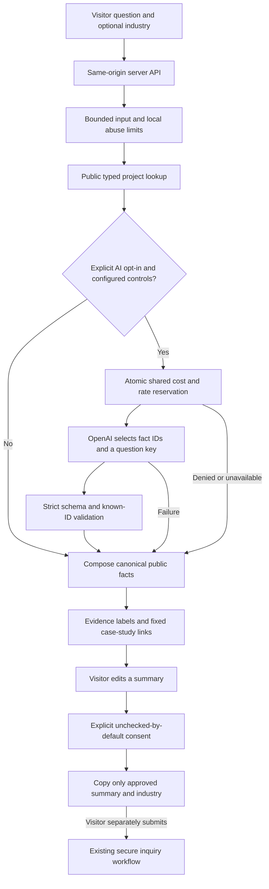

# Phase 5 — AI Solutions Advisor

Implemented locally on `codex/website-audit`, 2026-11-01. No deployment, live provider request, live Redis request, real lead submission or email delivery was performed. The application works immediately in public-lookup mode. Optional paid matching is implemented and tested with injected provider/budget fixtures; account-specific acceptance still requires operator configuration.

## Visitor experience

`/advisor` provides industry choices, suggested questions, a labeled composer, progressive loading/completion feedback, accessible response history, relevant case links and one qualification question. It is linked from the navigation and homepage selected-work section. No autoplay, typing-delay decoration, popups or nested scrolling widget is required. Responses are added after validation rather than streaming unvalidated model tokens. Keyboard-native controls, live announcements and an explicit latest-response link support navigation without moving focus on every answer.

The public lookup mode is clearly labeled when optional AI is unavailable. A separate unchecked AI-matching checkbox appears only when server configuration is ready. It authorizes sending the current question and retrieved public facts to the provider. Existing API keys are never requested from visitors.

## Architecture

The LLM ranks retrieved fact IDs and chooses one approved qualification question. It cannot supply displayed prose, change maturity/evidence labels, generate URLs, call tools or submit leads. All facts remain available, including planned scope and limitations, even if the model ranks only selected IDs. The server composes answers from the original records. This deliberate restriction protects the evidence boundary rather than relying on a prompt alone.

## Knowledge and grounding

The only knowledge source is the public `caseStudies` content model and its audited evidence distinctions. Retrieval uses the central project-to-industry mapping and a curated vocabulary in content.ts, with at most two relevant projects. It supports shared-sector projects, explicit project names and a single validated public project-context slug for short follow-ups. It does not send or store a conversation transcript. A changed sector cannot silently retain a mismatched follow-up project.

No files, private client documents, unpublished material, website crawling, vector store or external tool retrieval are ingested. Facts include authored maturity, reported implementation, development, planned work, scope to confirm, limitations, public sample context and any actually populated verified fields. The current model has no independently verified delivered product artifacts; reported capabilities remain reported. Unknown/unsupported confirmation requests return “I don't have verified information about that.” Scope questions can still receive the relevant public brief without pretending the underlying product is verified.

Lexical retrieval has limits: unknown terminology and subtle intent can produce no match or imperfect relevance. The advisor presents discussion starting points, not an automated engineering assessment. Update approved vocabulary and rerun evaluations when content changes. Evidence must still be reviewed by a human; the model cannot promote an authored claim into verified evidence.

## Consent and lead handoff

Chat is never automatically a lead. The visitor may open a review panel, edit a summary and check a separate consent box. Only that summary and the selected industry are copied into the existing Contact form. The action explicitly explains that it replaces those two fields; name, company and email fields remain untouched. It does not copy the full conversation or submit anything.

The Contact component validates the consent-bearing handoff event, clears stale delivery feedback and refuses replacement while a prior inquiry is sending. Focus moves to the editable inquiry brief after the copy. The visitor must then add necessary contact details and independently submit or prepare an email draft using the existing `/api/inquiry` workflow. No new CRM, transcript archive or automated sales-lead action is introduced. Further inquiry hardening remains Phase 6.

## Provider integration

The server-only adapter uses OpenAI Responses with strict structured output, `store: false`, no tools and a 256-token output cap. It is pinned to `gpt-5.4-mini-2026-03-17` with reasoning effort none. The official model page documents Responses/structured-output support and the snapshot. The request format follows [Structured Outputs](https://developers.openai.com/api/docs/guides/structured-outputs); model capabilities and pricing are described on the [GPT-5.4 mini page](https://developers.openai.com/api/docs/models/gpt-5.4-mini).

Upstream refusals, incomplete output, invalid schemas, unknown fact IDs, extra prose/URL fields, network errors and timeouts fall back to deterministic lookup. There is one provider attempt per accepted paid turn and no automatic retry. A provider response is not trusted just because its schema is syntactically valid: every selected ID must belong to the retrieved public set.

## Data handling and measurement

The page holds up to eight exchanges in React memory, with Clear conversation and request cancellation. It does not use persistent browser chat storage. Each server request contains the current question, optional industry, explicit AI opt-in and optional known public project context. The application writes no full transcripts, prompts, responses, inquiry content, names or email addresses to its metrics or a chat database.

AI opt-in sends that current question/public context to OpenAI. `store: false` does not mean zero provider retention: default abuse-monitoring logs may retain content for up to 30 days, with exceptions and account-specific controls. See [OpenAI data controls](https://developers.openai.com/api/docs/guides/your-data). The visible privacy notice explains this distinction. Basic personal-detail guards are not comprehensive redaction; visitors are told not to enter sensitive information.

`/api/advisor-metrics` accepts only the known event vocabulary and optional validated public project slug. Counts cover question_started, project_opened and handoff_started. Operational logs add lookup, provider_ok, provider_error, budget_error, budget_blocked and rate_limited; paid-path events include coarse latency buckets. Events contain no transcript or stable visitor ID. Metrics are indicative event counts, not unique visitors, verified leads or audited conversion statistics; anonymous public events can be spoofed or repeated.

Temporary rate keys use a secret HMAC of a rotating network identity; the raw address is not saved by this code. Local rate entries expire after about a minute; Redis client/minute counters expire after 120 seconds and monetary reservation keys after two days. These are pseudonymous abuse counters, distinct from chat content. Hosting/access logs and provider logs have separate retention policies that the operator must configure and disclose. Disable body/prompt capture in any added APM/log drain.

## Security and deployment notes

See advisor-security.md for controls and remaining limits, and advisor-deployment.md for environment setup, staged acceptance, costs and operations. Paid matching is disabled unless enabled explicitly with a provider key, sufficiently long rate secret and configured shared budget store. A failed shared budget reservation never falls through into an unmetered provider call. Public lookup remains available.

## Checks actually run

- TypeScript typecheck: PASS.
- Vitest: PASS, 11 files / 104 tests. The 69 previous tests remain; 35 new evaluations/behavior cases cover fabrication requests, unavailable capabilities, injections, confidentiality, off-topic requests, incorrect matching, planned-versus-verified claims, strict provider output, API failure, input limits, rate expiry, shared-budget denial/failure, concurrency, privacy metrics, opt-in, handoff consent, preserved fields and clearing pending answers.
- ESLint: PASS, 0 errors; the same 6 pre-existing fast-refresh warnings remain. A new ref-cleanup warning was corrected before delivery.
- Vercel build: PASS; existing tsconfig-path plugin suggestion remains.
- verify:vercel: PASS for advisor, existing pages, all ten case studies, unknown-route 404s, canonical/schema checks, gallery return state and inquiry validation. Advisor smoke checks use allowAI=false and verify public readiness, planned CAD facts, explicit unknown wording and strict rejection of extra file fields. No paid request or lead is sent by the smoke script.
- Client artifact scan: no OPENAI_API_KEY, UPSTASH_REDIS_REST_TOKEN or provider request-endpoint markers in generated client JavaScript. This is a targeted bundle-boundary check, not a full penetration test.
- git diff --check: PASS.

Browser QA exercised public BOQ lookup, relevant project output, review-panel consent initially unchecked, editing a non-sensitive test summary and copying it into the inquiry form without submission. Focus landed in the inquiry brief. Mobile/tablet/desktop layout and failure behavior are covered by targeted review/tests; physical device and dedicated screen-reader sessions were not performed. No actual OpenAI completion, live Redis atomicity, account/model access, provider retention configuration or real mailbox delivery was certified. Those remain staged acceptance steps, not claimed test results. Default Cloudflare build was not rerun in this phase.

## Phase 5 files

New: src/lib/advisor.ts; src/components/site/advisor/SolutionsAdvisor.tsx; src/advisor.css; src/server/advisor/{knowledge,protection,provider,handler,config}.server.ts; src/routes/advisor.tsx; src/routes/api.advisor.ts; src/routes/api.advisor-metrics.ts; src/test/advisor-server.test.ts; src/test/advisor-ui.test.ts; this handoff; advisor-security.md; advisor-deployment.md.

Updated: content.ts (public hints/prompts); Contact.tsx (consent-bearing prefill bridge); Nav.tsx and index.tsx (entry links); styles.css; generated route tree; .env.example; README.md; verify-vercel.mjs. No package or lockfile changes. Existing case studies, interactive demos and inquiry delivery contracts remain.

Stopped after Phase 5. Account configuration and staged/live acceptance are still required before enabling paid matching for production visitors.
